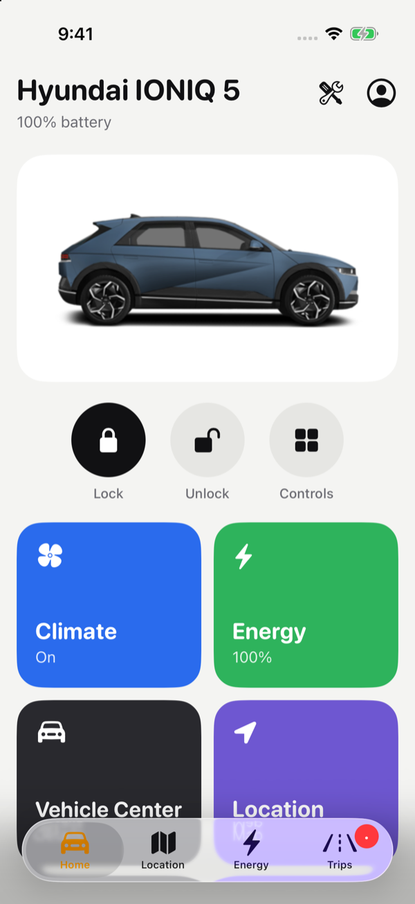
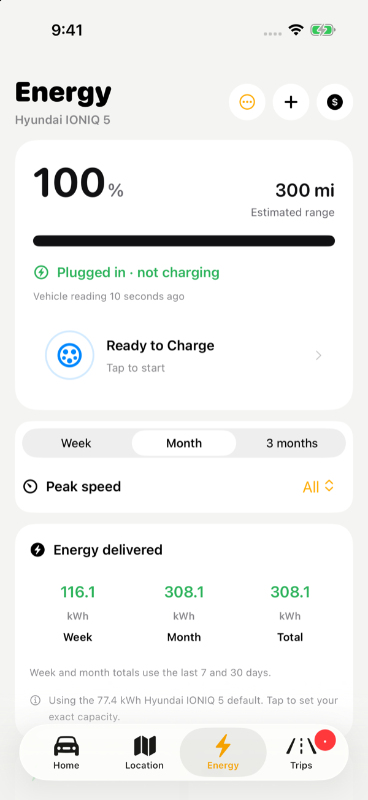
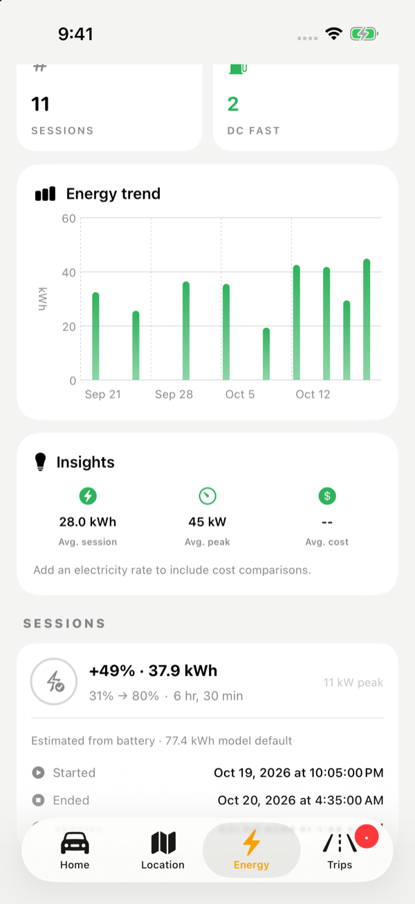
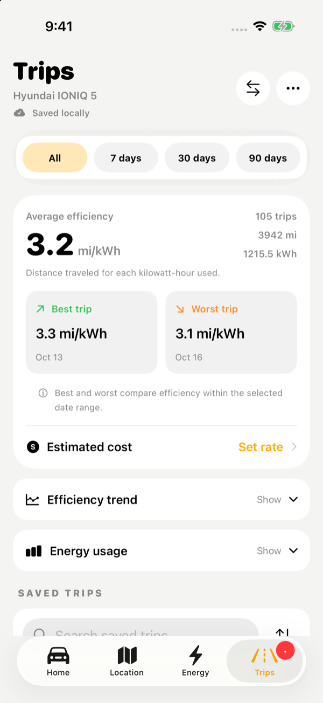

# GhostBlue

A native iPhone and Apple Watch app for Hyundai and Kia vehicles, built on
BlueLink and Kia Connect. It adds an EV energy dashboard, off-peak smart
charging, a durable trip archive and a Rivian-inspired theme to remote
control of the car. Built with SwiftUI and SwiftData on top of
[BetterBlueKit](https://github.com/schmidtwmark/BetterBlueKit).

<p align="center">
  
  
  
  
</p>
<p align="center"><sub>Home · Energy · Energy trend · Trips (demo vehicle, Rivian theme)</sub></p>

## Highlights

- **Energy tab.** Every charging session is detected and logged
  automatically: start and end, charge added, energy, peak power, AC or DC,
  home or public, and cost. A daily or weekly energy trend sits alongside.
- **Off-peak smart charging.** GhostBlue starts and pauses home charging to
  stay inside SDG&E's super off-peak windows, driven by Shortcuts and
  verified against the car's reported status.
- **Automations and smart alerts.** You get notified when charging finishes or
  stops early, when the car is unplugged or unlocked, and when the battery,
  12V or tyres need attention. A daily reminder to precondition is available too.
- **Trip archive.** Trips are kept on the device beyond the API's rolling
  window, with efficiency, best and worst trips, energy breakdowns and
  cost estimates.
- **Rivian theme.** An optional light dashboard with large command buttons,
  colour-coded tiles and themed widgets and Live Activities, alongside four
  classic themes.
- **Gentle on the car.** GhostBlue forces a real-time read only when you ask
  for one or a command needs verifying. Real-time reads wake the car's modem,
  which costs 12V charge and counts against BlueLink's rate limits.

## Features

### Vehicle control
- Lock and unlock.
- Climate start and stop, with saved presets: temperature, defrost, heated
  seats and steering wheel, and duration where the region supports it.
- Start and stop charging, and set the AC and DC charge limits.
- Status at a glance: battery or fuel level, range, plug state, doors, hood
  and trunk, tyre pressure, 12V battery and location.
- Several vehicles and accounts, with multi-factor sign-in where the brand
  requires it.
- Supported services: Hyundai USA, Kia USA, and Hyundai Canada and Europe
  (beta). A **demo mode** with simulated vehicles needs no car.

### Energy (Charging tab)
- **Automatic sessions.** Status refreshes in the app, widgets, watch and
  Shortcuts all feed the same log. A session ends at once when the car is
  unplugged, reaches its target, or GhostBlue sent the stop. A "not charging"
  reading that nothing contradicts for 15 minutes also ends it, so brief
  BlueLink glitches don't split a charge.
- **Energy.** Charge added × usable battery capacity. The capacity is either
  yours or a labelled model default (77.4 kWh for an IONIQ 5). Samples of
  charger power are a fallback, capped by the charge actually added.
- **Trends.** Week, month and three-month views with daily or weekly bars,
  plus energy totals, session count, DC fast sessions, average session and
  average peak power. You can filter by peak charging speed.
- **Costs.**
  - Separate rates for home off-peak, public DC and other charging.
  - Each session keeps a snapshot of the time-of-use tariff it was charged
    under, so later rate changes don't rewrite its cost.
  - A receipt total can override the estimate.
  - A monthly budget is tracked in Vehicle Center.
- **Editing.** You can add a session by hand, edit or correct any session, and
  export the selected period as CSV.

### Off-peak smart charging (SDG&E)
- Charge windows: weekdays 12–6 AM and 10 AM–2 PM; weekends and SDG&E holidays
  12 AM–2 PM. This matches SDG&E's EV-TOU super off-peak hours as of 2026, but
  check them against your own plan.
- The **Reconcile Smart Charging** action starts or pauses charging so the
  car matches the current window.
  - It confirms each change against the car's reported status.
  - It stops at your target charge level.
  - It only acts at home (an on-device geofence) and never touches a DC fast
    session.
- **Charge now** and **Skip this window** override the schedule until the next
  boundary.
- Run it from a Shortcuts automation at each window boundary. GhostBlue also
  catches up when opened, and warns if a scheduled check was missed.

### Automations and alerts
- **Smart alerts, set per vehicle:** charging complete, charging interrupted,
  unlocked, a door or panel left open, low EV battery, low 12V battery and a
  tyre pressure warning. Quiet hours are respected.
- **Personal automations:**
  - Notify when the battery drops below a percentage.
  - Notify when the car is unplugged.
  - A daily reminder to precondition.
- **Maintenance reminders** by date or odometer.
- A **remote activity log** of every command from the iPhone, widgets,
  Shortcuts and Watch.

### Trips
- Trips are archived locally, so history outlives the API's short window.
- Efficiency in mi/kWh or km/kWh, best and worst trips, efficiency trend,
  energy-usage breakdown and estimated cost.
- Search, favourites, custom names and CSV export.
- Trip details are available for Hyundai USA and in demo mode.

### Map and route planning
- The vehicle's location on a map, with a privacy option to hide it.
- Trip planning and live telemetry through
  [A Better Routeplanner](https://abetterrouteplanner.com) (needs an ABRP
  token).

### Widgets, Watch and Shortcuts
- **Home Screen widgets:** GhostBlue, Charge Dial, Command Center, Hero Card and
  Woven Wordmark, with Rivian-styled versions under the Rivian theme.
- **Lock Screen:** Range Ring, a ring, line or inline readout of charge and range.
- **Control Center:** lock, unlock, start or stop climate, start or stop charging.
- **Live Activities:** charging and climate progress on the Lock Screen and in
  the Dynamic Island.
- **Apple Watch:** an app with lock, climate and charging controls, plus
  complications.
- **Shortcuts and Siri:** Lock, Unlock, Start/Stop Climate, Start/Stop
  Charging, Set Charge Limits, Refresh/Get Vehicle Status and Reconcile
  Smart Charging.

### Personalisation
- Themes: Midnight, Hyundai Blue, Aurora, Minimal and Rivian, with a choice of
  accent colour.
- Car colour, custom vehicle names, distance and temperature units.
- An editable Home dashboard: reorder, resize or hide the Smart Briefing,
  Charging, Vehicle Health, Vehicle Status and Location sections.

### Data and privacy
- Data lives in an on-device SwiftData store, shared with the widgets and
  Watch through an App Group. iCloud sync is off by default.
- Optional **Face ID** lock.
- The home geofence and location stay on the device. CSV exports leave out
  the VIN.
- **Backup & Restore** writes everything except HTTP logs to a JSON file.
  Restoring merges the file into your data without overwriting anything.
- **Privacy & Security** can delete trips, sessions, activity, reminders and
  automations.

## Getting started

**Requirements:** Xcode 26 or later, an iOS 26 device or simulator,
watchOS 26 for the Watch app, and an active BlueLink or Kia Connect
subscription for a real car.

```bash
git clone --recurse-submodules git@github.com:Sai-Venkat-Krishna/GhostBlue.git
cd GhostBlue
open GhostBlue.xcodeproj
```

If you cloned without submodules, run
`git submodule update --init --recursive`.

1. In each target's Signing & Capabilities, select your team. Change the
   bundle identifiers and the App Group
   (`group.com.saivenkatkrishna.ghostblue.shared`) if you are signing with a
   different account.
2. Build and run the **GhostBlue** scheme.
3. To try the app without a car, sign in with `testaccount@betterblue.com`
   and password `betterblue`. That account creates simulated vehicles whose
   charge, climate and locks respond to commands.

Command-line build and tests:

```bash
xcodebuild -scheme GhostBlue -destination 'platform=iOS Simulator,name=iPhone 17 Pro' build
xcodebuild test -scheme GhostBlue -destination 'platform=iOS Simulator,name=iPhone 17 Pro'
```

The unit tests cover:
- charging-session accuracy;
- the off-peak automation, run end to end against the demo vehicle;
- tariffs and costs;
- automation reminders;
- backup and restore;
- the store reconciler;
- car wake-up behaviour.

## Live Activities

Live Activities are off by default; turn them on in Settings → Widget
Settings. While the app is in the background they are refreshed by silent
pushes from the service in [LiveActivityBackend/](LiveActivityBackend/). That
service receives only a device push token, which it deletes after 8 hours,
and never sees vehicle data or credentials. The app is currently configured
with the original author's endpoint
([LiveActivityManager.swift](GhostBlue/Utility/LiveActivityManager.swift)).
To get background updates for your own build, deploy the backend with your
own APNs key and point the app at it.

## Project structure

```
GhostBlue/
├── GhostBlue/                  # iOS app
│   ├── Models/                 # SwiftData models (accounts, vehicles, sessions, trips…)
│   ├── Views/                  # SwiftUI screens, components and the Rivian design system
│   └── Utility/                # API client wrappers, smart charging, backup, settings
├── GhostBlueWatch Watch App/   # Apple Watch app
├── Widget/                     # Widgets, Control Center, Live Activities, App Intents
├── WatchWidget/                # Watch complications
├── GhostBlueTests/             # Unit tests
├── LiveActivityBackend/        # Push service for Live Activity refreshes
├── BetterBlueKit/              # Submodule: Hyundai/Kia API clients
└── docs/screenshots/           # README screenshots
```

See [CLAUDE.md](CLAUDE.md) for an architecture walkthrough and
[Troubleshooting.md](Troubleshooting.md) for sign-in, Watch syncing, widget
and supported-region issues. For HTTP request logs, enable debug mode, then open Settings → HTTP Logs.

## Important notes

- **Unofficial.** This app is not affiliated with Hyundai or Kia. Use it in line
  with your connected-services terms.
- **Subscription required.** Remote features need an active BlueLink or Kia
  Connect subscription.
- **12V battery.** Real-time reads and remote commands wake the car. GhostBlue
  limits them, but frequent manual refreshes still drain the 12V battery and
  can hit rate limits.
- **Estimates.** Charging energy and cost are estimates unless you enter a
  meter reading or receipt.

## Credits and license

GhostBlue was created by [Mark Schmidt](https://markschmidt.io/ghostblue), and
this version builds on his app and on
[BetterBlueKit](https://github.com/schmidtwmark/BetterBlueKit). It is
released under the MIT License; see [LICENSE](LICENSE).
